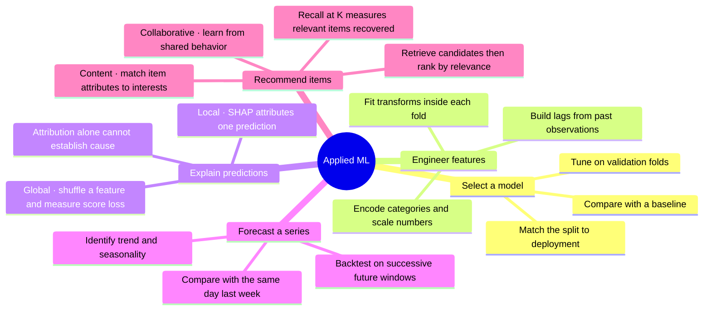

# Applied machine learning revision notes

Imagine you run a bookshop. Predicting next week's sales, explaining one unusually high forecast and choosing five books for a reader are three different tasks. The prediction target determines what information you may use, how to split the data and which score describes success.

For exam practice, try the [applied ML scenario questions](scenario-practice.md#applied-ml-practice). Each has four choices and a worked explanation.

## 1. Model selection

**Choose the evaluation before tuning the model.** Define the prediction time, the unit you predict for and the cost of a mistake. Set aside a final test set that matches deployment. Compare a simple baseline and candidate models on the same validation folds, choose hyperparameters, then refit the chosen pipeline on all development data. Use the test set once for the final estimate.

| What will the model face? | Suitable validation design | What can go wrong? |
|---|---|---|
| Independent examples from the same population | K-fold cross-validation, stratified for classification when appropriate | Rare classes may be missing from a fold |
| A customer or store never seen in training | Group folds by customer or store | Repeated observations can let the model recognize an entity |
| A future week | Train on earlier weeks and validate on later weeks | Shuffling lets future patterns influence model selection |

**Match the metric to the decision.** For regression, mean absolute error (MAE) gives average error in the target's units. Root mean squared error (RMSE) gives larger errors more influence. For classification, precision is the fraction of flagged cases that are positive, and recall is the fraction of actual positives caught. Choose a decision threshold on validation data to reflect review capacity or the cost of a miss.

**Worked example.** Of 100 orders, 10 arrive late. A model flags 8 orders and 6 actually arrive late. Precision is 6/8 = 75% and recall is 6/10 = 60%. An “always on time” baseline achieves 90% accuracy while catching zero late orders.

**Diagnose the gap.** High training and validation errors suggest underfitting if a better score is feasible. Low training error alongside much higher validation error suggests overfitting or a shift between splits. If you use cross-validation both to tune candidates and to estimate the whole selection procedure's performance, use nested folds. The inner folds tune and the outer folds evaluate. [Practice model selection](https://jeevchiran.github.io/learnings-ai-ml/#/module/me-m1)

## 2. Feature engineering

A feature is usable only if you could compute it when making the prediction. For a delivery estimate at checkout, distance and promised service level are available. The eventual delivery timestamp reveals the answer. Cross-validation cannot repair a feature built from future information.

| Input | Common transformation | Detail worth remembering |
|---|---|---|
| Numeric measurements | Impute missing values and standardize for distance-based or regularized linear models | Learn the median, mean and scale from each training fold |
| Unordered categories | One-hot encode small vocabularies | Plan for unseen categories. Integer IDs can imply a false order |
| High-cardinality categories | Encode a category using its average target | Generate training encodings out of fold and respect time order for forecasting |
| Timestamps and histories | Extract weekday, time since last event or lagged sales | End the history window at the prediction cutoff |
| Related measurements | Combine quantities with meaningful units | Revenue divided by units gives unit price. Decide how to handle zero units |

**Selection vs. extraction.** A filter ranks original features by a statistic, a wrapper compares subsets by validation performance, and an embedded method like L1-regularized regression can shrink coefficients to zero during fitting. Principal component analysis (PCA) creates new linear combinations that capture variance. High variance alone does not establish predictive value. Fit every learned transformation and selection step inside the training pipeline. [Practice leakage-safe feature selection](https://jeevchiran.github.io/learnings-ai-ml/#/module/me-m8)

## 3. Explainability

Start with the question you want the explanation to answer.

| Question | Method | Interpretation |
|---|---|---|
| Which inputs help this model perform well overall? | Permutation importance | Shuffle one column on held-out data and measure the score drop. Correlated features can substitute for each other and hide importance |
| How does the prediction vary across prices? | Partial dependence plot (PDP) | Vary price and average predictions across examples. Correlated inputs can create implausible combinations. Individual conditional expectation (ICE) curves show variation across examples |
| Why did this book receive this forecast? | SHAP | Allocate the difference between a reference output and the prediction among features. The reference data and output scale affect the explanation |
| What simple rule approximates the model near this example? | LIME | Fit an interpretable surrogate on weighted nearby perturbations. Check its local fit and whether those perturbations are realistic |

**Worked example.** A forecast has a SHAP reference value of 40 books. On the sales scale, a promotion contributes +12 and weekday contributes −3, with all other contributions zero. The forecast is 49 books. The +12 describes the model's attribution. Estimating how many extra books the promotion *caused* requires a causal design, such as a randomized promotion. [Practice SHAP](https://jeevchiran.github.io/learnings-ai-ml/#/module/xai-m5)

## 4. Time series analysis and forecasting

**Read the series first.** Plot it in time order. Look for trend (long-run movement), seasonality (a repeating calendar pattern), missing periods and abrupt changes. Autocorrelation measures association between values separated by a lag. A peak at lag 7 in daily sales suggests checking a weekly pattern.

| Model | What it uses | When to try it |
|---|---|---|
| Naive or seasonal naive | Last observation or last observation at the same seasonal position | Establish how much the model gains over persistence or repetition |
| Exponential smoothing | A level that weights recent observations more heavily, optionally with trend and seasonality | A series with an evolving level or seasonal pattern |
| ARIMA(p, d, q) | Past values, differencing and past forecast errors | Differencing can stabilize a changing level. Check residual autocorrelation for structure the model missed |
| Regression with lag features | Past observations plus predictors known at the forecast origin | Promotions or calendar effects explain demand. Any future predictor also needs a known value or its own forecast |

**Worked backtest.** On Sunday evening you must forecast the next seven days. Train through Sunday, forecast Monday through Sunday, then advance the origin one week and repeat. Compare every model against sales on the same weekday last week. Last Monday sold 80 and this Monday sold 92, so Monday's seasonal-naive absolute error is 12. Score each horizon across multiple origins to see whether day seven is harder than day one.

**Common trap.** For a forecast issued on Sunday, a Tuesday feature containing Monday's *actual* sales leaks information. A recursive forecast can use Monday's *predicted* sales, with uncertainty carrying forward. For prediction intervals, check both coverage and width on held-out forecasts. An 80% interval should contain roughly 80% of observed outcomes over comparable forecasts. [Practice time series forecasting](https://jeevchiran.github.io/learnings-ai-ml/#/module/ts-m1)

## 5. Recommender systems

The output is usually a ranked list for a particular user. **Retrieval** finds a manageable set of plausible items, **ranking** scores them for the user and context, and **reranking** can enforce availability or improve diversity. A ranker can only promote items that retrieval returned.

| Approach | Signal | Cold-start behavior |
|---|---|---|
| Popularity baseline | Recent aggregate popularity | Works for a first-time visitor but gives similar lists to many people |
| Content-based | Similarity between item attributes and a user's interests | Can recommend a new book from its description, given a reader profile |
| Collaborative filtering | Shared patterns in user–item interactions | Matrix factorization learns user and item vectors whose dot product estimates affinity. Sparse or new entities have weak interaction evidence |
| Hybrid | Behavior plus content or context | Can use metadata for a new title and gradually incorporate reader feedback |

**Worked ranking.** A reader has four relevant held-out books. Two appear in the top five, so precision@5 = 2/5 and recall@5 = 2/4. Moving those hits from positions 4 and 5 to 1 and 2 leaves both metrics unchanged but improves normalized discounted cumulative gain (NDCG@5), which rewards earlier relevant results.

**Evaluate realistic exposure.** Split interactions by time and rank items available at that time. A missing click can mean the user never saw the book. Offline ranking metrics measure agreement with recorded behavior. An online randomized test can measure effects on discovery, purchases or repeated use. [Practice collaborative filtering](https://jeevchiran.github.io/learnings-ai-ml/#/module/rs-m7)

## Test yourself

1. You scale the entire dataset and select the ten features most correlated with the target before cross-validation. Which steps must move?
2. A customer appears in ten rows. Which split tests performance on entirely new customers?
3. Two models have similar MAE, but one has much worse RMSE. What should you inspect?
4. Price has low permutation importance when discount price is also present. What might explain this?
5. You issue a seven-day forecast every Sunday. When may you use Wednesday's actual sales?
6. A new book has a description and no clicks. Which recommender has immediate item evidence?

**Answers**

1. Fit both scaling and feature selection inside each training fold. Apply those fitted transformations to its validation fold.
2. Group by customer so all rows from one customer stay on the same side.
3. Inspect the largest residuals. Squaring makes a few large misses count heavily.
4. The model can still recover similar information through the correlated discount price.
5. Once Wednesday's sales are recorded, they may inform a newly issued forecast. Keep them out of the original Sunday forecast.
6. A content-based recommender can match the book's description to a reader's interests.
