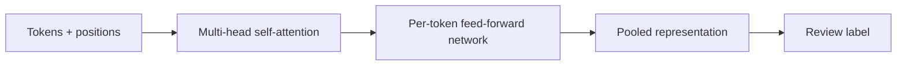
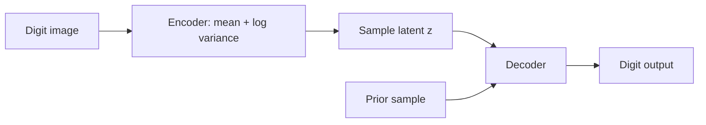
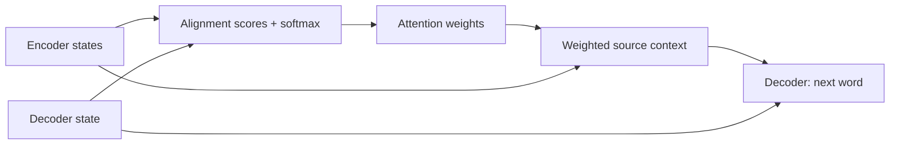
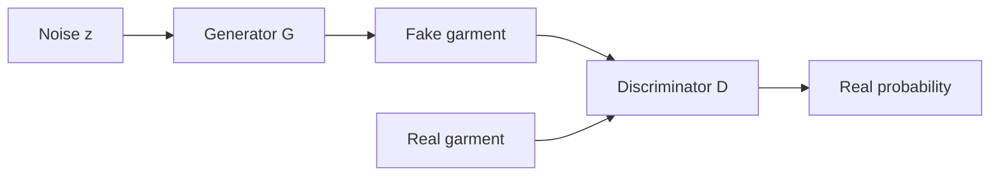
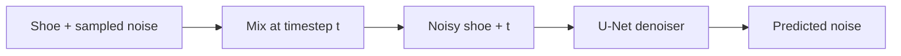

# Neural network architectures for MCQs

Six model sheets, twelve single-answer questions, and a worked answer key. Each diagram follows one example through the architecture.

## 1. Transformers

**Memory cue:** Each token builds a new representation by taking a weighted mixture of other tokens' values. The attention mask determines which tokens it can use.

### Architecture

In a review classifier, the word “bank” can pick up information from “river.” Follow one encoder block below. Each token has its own row of attention weights.

**Inside the block.** A query represents what a token seeks, a key represents what a token can match, and a value carries the information to mix. Each head computes `softmax(QKᵀ / √dₖ) V`, with softmax across allowed key positions. Heads learn separate projections. Residual connections and layer normalization support training.

### Variants and use cases

| Architecture | What changes | Example use case |
|---|---|---|
| Encoder-only · BERT | Bidirectional self-attention gives each token left and right context. | Classify the sentiment of a complete review. |
| Decoder-only · GPT | Causal self-attention limits each position to itself and earlier tokens. | Continue a prompt one token at a time. |
| Encoder–decoder · T5 | The encoder reads the source. The decoder uses causal self-attention and cross-attends to encoder outputs. | Translate an English sentence into French. |

### Training, inference, and pitfalls

- **Next-token prediction.** A causal language model trains on shifted targets with cross-entropy. The mask permits training on many positions in parallel. Generation still appends one token at a time.
- **Future-token leakage.** If a next-token model sees later target tokens during training, apply a causal mask before softmax. A padding mask serves a different purpose: it hides padded positions.
- **Word order.** Plain self-attention has no built-in representation of token order. Supply position information, for example through positional embeddings.

## 2. Variational autoencoders (VAEs)

**Memory cue:** Encode a distribution, sample a latent code, then decode. The reconstruction term rewards fidelity, and the KL term keeps the code distribution close to a chosen prior.

### Architecture

For a handwritten digit, reconstruction starts with the image. Generating a fresh digit starts at the prior and uses the same decoder.

**Inside the sampler.** For a diagonal Gaussian encoder, compute `σ = exp(0.5 × log variance)`, draw standard normal noise ε, and set `z = μ + σ × ε` elementwise. This reparameterization lets reconstruction gradients reach the encoder through μ and σ.

### Variants and use cases

| Architecture | What changes | Example use case |
|---|---|---|
| Standard VAE | Minimize reconstruction loss plus KL divergence from the encoder distribution to the prior. | Draw new handwritten digits by decoding samples from a standard normal prior. |
| β-VAE | Multiply the KL term by β. A larger β increases pressure to match the prior and can trade detail for more separated latent factors. | Explore whether latent directions capture shape or stroke width. |
| Conditional VAE | Give a condition such as a class label to both encoder and decoder. | Request the digit 7 and sample several handwriting styles. |

### Training, inference, and pitfalls

- **Loss sign.** Minimize negative ELBO: expected negative log-likelihood of the reconstruction plus KL divergence. Equivalently, maximize the ELBO.
- **Posterior collapse.** If KL stays near zero and changing z barely changes the output, the decoder may be ignoring z. Gradually increase the KL weight during training to help the encoder learn a useful code.
- **Poor reconstruction after raising β.** Strong regularization can discard detail. Lower β when reconstruction quality is the priority.

## 3. Attention-based encoder–decoder

**Memory cue:** In recurrent sequence-to-sequence translation, the decoder gets a fresh weighted view of the source for every target word.

### Architecture

While translating “I drink coffee,” the decoder can give “coffee” a high weight when predicting “café.” It can choose a different source word on the following step.

**Inside one step.** Score each encoder state against the decoder state. Softmax gives weights that sum to one over valid source positions. Add the weighted encoder states to obtain context. For scalar states 2 and 8 with weights 0.25 and 0.75, the context is `0.25 × 2 + 0.75 × 8 = 6.5`. The decoder uses the context and its state to predict the next word.

### Variants and use cases

| Architecture | What changes | Example use case |
|---|---|---|
| Plain recurrent encoder–decoder | The encoder summarizes the source in a fixed vector. | Map a short command to a short response. |
| Bahdanau · additive attention | A learned feed-forward network scores a decoder state and each encoder state. | Translate a sentence while learning soft word alignments. |
| Luong · dot or general attention | Score with a dot product or a learned bilinear form. | Translate with efficient matrix-based alignment scoring. |

### Training, inference, and pitfalls

- **Teacher forcing.** During training, the decoder can receive the correct previous target word. At inference it consumes its own previous prediction and stops at an end token or length limit.
- **Fixed-vector bottleneck.** If early source words are forgotten, keep all encoder states and attend over them at each decoder step. Alignment can be learned from target-token loss.
- **Attention on padding.** Mask padded source positions before softmax. The recurrent decoder still generates sequentially even when source attention is available.

## 4. Convolutional neural networks (CNNs)

**Memory cue:** Slide the same learned filter across an input. Each output value records how strongly a local patch matches that filter.

### Architecture

A digit classifier first detects local strokes, then combines them into larger patterns. The final layer produces one score per digit class.

**Count it.** For dilation 1, output width is `floor((width + 2 × padding − kernel width) / stride) + 1`. For a standard convolution with bias, parameters equal `(kernel height × kernel width × input channels + 1) × filters`. A 3 × 3 kernel, 3 input channels, and 16 filters give 448 parameters regardless of the image width.

### Variants and use cases

| Architecture | What changes | Example use case |
|---|---|---|
| 1D CNN | A filter slides along one axis, usually time or sequence position. | Detect a short vibration pattern in a sensor stream. |
| 2D CNN | Filters move across height and width and combine input channels. | Classify a handwritten digit from its image. |
| 3D CNN | Filters move across three axes, such as time, height, and width. | Recognize a short action in a video clip. |

### Training, inference, and pitfalls

- **Shared weights.** Every spatial position uses the same kernel. Backpropagation combines contributions from all positions to update it. At inference the learned filters stay fixed.
- **Small objects disappear.** Early pooling or large strides can discard detail. Reduce early downsampling when the task needs precise localization.
- **High training accuracy, low validation accuracy.** This suggests overfitting. Use label-preserving augmentation on training images. For example, small shifts preserve most digit labels.

## 5. Generative adversarial networks (GANs)

**Memory cue:** The generator G makes a sample. The discriminator D scores it. During a generator update, gradients pass through D while only G's weights change.

### Architecture

To learn clothing images, D sees real garments from the dataset and fake ones from G. The same D judges both. At generation time, fresh noise and G alone produce a new garment.

**Minimax game.** D maximizes `E[log D(x)] + E[log(1 − D(G(z)))]`. The first term rewards high scores on real images. G minimizes the second term by making fakes score higher. With equally likely real and fake inputs and matching distributions, an optimal D outputs 0.5.

### Variants and use cases

| Architecture | What changes | Example use case |
|---|---|---|
| Vanilla GAN | G maps noise to a sample. D predicts a real/fake probability. | Generate random handwritten digits. |
| DCGAN | G upsamples with convolutions. D downsamples with convolutions. | Synthesize clothing textures. |
| Conditional GAN | Both G and D receive a condition such as a class label. | Request a sneaker in different styles. |
| WGAN | A critic gives real-valued scores. Original WGAN clips its weights. | Guide G when real and fake images are easy to separate. |
| WGAN-GP | Penalize deviations of the critic's input-gradient norm from 1 on interpolated samples. | Train an image critic when clipping restricts learning. |
| pix2pix | A U-Net and patch discriminator learn from paired images. | Turn a shoe outline into its matching photo. |
| CycleGAN | Two generators and two discriminators learn unpaired translation with a round-trip loss. | Translate horse photos into zebra images. |

### Training, inference, and pitfalls

- **Mode collapse.** Many noise vectors produce nearly identical sneakers. Minibatch discrimination lets D detect low diversity across a batch.
- **Weak gradients.** When D confidently rejects fakes, use the non-saturating generator loss, `−log D(G(z))`, to give G a stronger signal.
- **Oscillation.** Tune the relative learning rates or update counts of G and D when one repeatedly outpaces the other.

## 6. Diffusion models

**Memory cue:** Training asks the denoiser to predict known noise at one sampled timestep. Generation starts with fresh noise and calls the denoiser repeatedly.

### Architecture

In a denoising diffusion probabilistic model (DDPM) trained to predict noise, keep the noise you add to a clean shoe image. That exact noise is the target. The timestep tells the denoiser how noisy its input is expected to be.

**One update.** Form `xₜ = √ᾱₜ x₀ + √(1 − ᾱₜ) ε`, where ᾱₜ is the cumulative signal fraction and ε is standard Gaussian noise. Minimize mean squared error between ε and the prediction. At generation time, the sampler uses that prediction and the noise schedule to take a reverse step.

### Variants and use cases

| Variant or technique | What changes | Example use case |
|---|---|---|
| DDPM | A timestep-conditioned denoiser supports stochastic reverse steps. | Generate a new clothing image from noise. |
| DDIM sampler | Reuse a trained denoiser with fewer steps. With η = 0, a fixed start gives a deterministic path. | Preview clothing designs faster. |
| Conditional diffusion | Feed a class, prompt, or other condition to the denoiser. | Generate a sneaker on request. |
| Latent diffusion | Encode images, denoise in compressed latent space, then decode to pixels. | Reduce the cost of high-resolution synthesis. |
| Classifier-free guidance | Combine conditional and unconditional predictions at sampling time. | Make an image follow “red sneaker” more closely. |

### Training, inference, and pitfalls

- **Missing timestep.** Inject a timestep embedding into the U-Net's residual blocks during training and sampling so the predicted update fits the noise level.
- **Slow generation.** Each reverse step costs a denoiser call. Use a shorter DDIM schedule and check sample quality.
- **Over-guidance.** If high guidance creates distorted or repetitive samples, lower the guidance scale.

## Practice MCQs

Choose one answer per question. Each pair tests one of the six model families.

**1. A decoder-only model predicts the next token accurately in training but can read future target tokens. Which change fixes the leak?**

A. Increase the number of heads · B. Apply a causal mask · C. Remove position embeddings · D. Mask only padding

**2. A translation transformer is generating its third French word. In its cross-attention layer, where do the queries and keys come from?**

A. Both from the English encoder · B. Both from the French decoder · C. Queries from the encoder, keys from the decoder · D. Queries from the decoder, keys from the encoder

**3. A VAE has μ = 2, σ = 0.5, and sampled noise ε = −2 in one latent dimension. What is z?**

A. 1 · B. 0 · C. 2.5 · D. −1

**4. A VAE decoder produces nearly identical outputs when z changes, and KL stays near zero. Which change targets the likely problem?**

A. Remove reconstruction loss · B. Increase β sharply at the start · C. Start with a small KL weight and increase it gradually · D. Fix z at zero

**5. Source states are 4 and 10. Their attention weights at one decoder step are 0.75 and 0.25. What is the scalar context?**

A. 7 · B. 5.5 · C. 8.5 · D. 14

**6. A recurrent decoder receives the correct previous word during training and its own previous prediction during inference. What is the training technique?**

A. Beam search · B. Weight sharing · C. Causal masking · D. Teacher forcing

**7. A standard 2D convolution uses eight 3 × 3 filters on an RGB image, with one bias per filter. How many trainable parameters are there?**

A. 224 · B. 216 · C. 72 · D. 80

**8. A model must locate a two-pixel scratch. After aggressive early pooling, the scratch disappears from the feature maps. Which change most directly preserves it?**

A. Add more output classes · B. Increase the pooling stride · C. Reduce early downsampling · D. Replace ReLU with softmax

**9. A GAN produces convincing but nearly identical sneakers for 100 different noise vectors. Which change directly helps D detect the problem?**

A. Clip each output pixel · B. Give D minibatch similarity features · C. Freeze G permanently · D. Use the same noise for every sample

**10. An implementation gives each image a critic score and penalizes the critic's input-gradient norm when it differs from 1 on interpolated images. Which variant is this?**

A. DCGAN · B. pix2pix · C. Original WGAN with weight clipping · D. WGAN-GP

**11. A diffusion denoiser receives a noisy shoe but lacks its timestep. Which modification directly restores noise-level information?**

A. Inject a timestep embedding into denoiser blocks · B. Raise the guidance scale · C. Add a GAN discriminator · D. Use fewer reverse steps

**12. A team has a trained noise predictor and wants faster previews with fewer reverse steps, without retraining the network. Which change fits?**

A. Increase U-Net depth · B. Add more training timesteps · C. Use a shorter DDIM sampling schedule · D. Increase the guidance scale

## Answer key and quick recall

| MCQ | Answer | Why it follows |
|---|---|---|
| 1 | B · Causal mask | It blocks later target positions before attention weights are computed. Padding masks only remove padding. |
| 2 | D · Decoder queries, encoder keys | The target position retrieves source information. The encoder also supplies the values. |
| 3 | A · 1 | Apply z = μ + σ × ε. Here 2 + 0.5 × (−2) = 1. |
| 4 | C · Gradual KL weighting | The symptoms suggest posterior collapse. A low initial KL weight lets the encoder use z for reconstruction. |
| 5 | B · 5.5 | The context is the weighted sum, 0.75 × 4 + 0.25 × 10 = 5.5. |
| 6 | D · Teacher forcing | The defining clue is who supplies the previous target token during training. |
| 7 | A · 224 | Each filter has 3 × 3 × 3 weights and one bias. Eight filters give 8 × 28 = 224. |
| 8 | C · Reduce early downsampling | Retaining spatial resolution gives later layers a chance to detect the tiny feature. |
| 9 | B · Minibatch discrimination | Similarity within a batch lets D detect the lack of variety even when individual sneakers look realistic. |
| 10 | D · WGAN-GP | The gradient penalty acts on the critic along paths between real and generated samples. |
| 11 | A · Timestep embedding | The same network denoises at many noise levels. The embedding identifies the current step. |
| 12 | C · Shorter DDIM schedule | DDIM can reuse the trained predictor while skipping timesteps, reducing denoiser calls. |

### Six clues to remember

- **Tokens exchanging information within one sequence** → self-attention. A target position retrieving source information → cross-attention.
- **Mean, variance, and a sampled code** → VAE. Sampling from the prior and decoding produces a new example.
- **A new weighted source context for each target word** → encoder–decoder attention. Changing target steps can change the alignment.
- **One filter reused at every location** → CNN. More spatial positions increase computation while the parameter count stays fixed.
- **A learned judge supplies the training signal** → GAN. A probability suggests a vanilla discriminator. A critic with a gradient penalty suggests WGAN-GP.
- **The noise you added is the target** → noise-prediction diffusion. Learn at a sampled timestep, then generate through repeated reverse updates.
