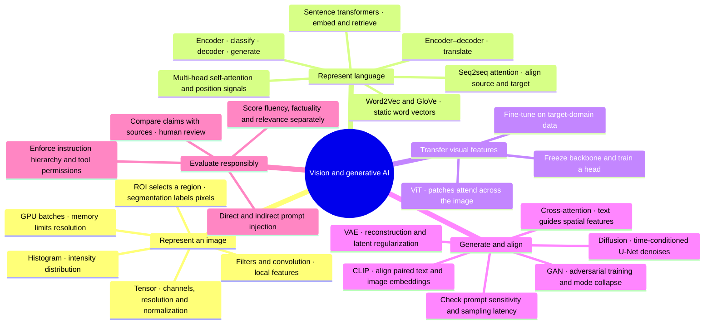

# Computer vision and generative AI revision notes

Revision scope follows the instructor outline and question bank in *GenAI Revision 1.pdf*. [Print the two-page A4 cheat sheet](ml-and-genai-cheatsheet.pdf).

Follow two examples through these notes. In **image captioning**, an image supplies evidence to a language model that writes text. In **text-to-image generation**, a prompt guides the creation of an image. For either task, identify the input representation, what the model learns during training and how it produces an output at inference.

For exam practice, try the [vision and GenAI scenario questions](scenario-practice.md#vision-and-genai-practice). Each has four choices and a worked explanation.

## 1. Image fundamentals

- **Pixels and channels.** A grayscale image has one intensity channel. An RGB image has red, green and blue channels. A 224 × 224 RGB image has 150,528 channel values. A framework may store one image as height × width × channels or channels × height × width. Check the layout, channel order and value range expected by a pretrained model.
- **Sampling and quantization.** Resolution counts spatial samples. Bit depth determines how many levels each channel can represent. Eight bits give 256 levels per channel. Downsampling can erase a thin line or create false patterns through aliasing. Low-pass filtering before downsampling reduces aliasing.
- **Convolution.** A small learned kernel slides across the image, reusing weights to detect a pattern in different places. Stride controls the spacing between outputs and padding controls how the borders are treated. On a 5 × 5 input, a 3 × 3 kernel at stride 1 with no padding gives a 3 × 3 feature map. Stacking layers lets later features combine information over a larger receptive field.
- **Preprocessing and augmentation.** Resize or crop to the expected dimensions and use the pretrained model's normalization. Apply random augmentation to training examples only when it preserves their meaning. Flipping a street sign may reverse its lettering. For segmentation, a geometric transform must move the image and its label mask together.

| Task | Output for a street photo | Example evaluation |
|---|---|---|
| Classification | One scene label, such as “street” | Accuracy or per-class recall |
| Detection | A box and category for each vehicle | Average precision with an intersection-over-union matching criterion |
| Segmentation | A class for each pixel | Intersection over union, the area of overlap divided by the area of union |
| Generation | A new street scene matching a prompt | Judge visual fidelity, diversity and prompt adherence separately |

For example, if two masks overlap on 30 pixels and cover 50 distinct pixels in total, their intersection over union is 30/50 = 0.60. [Practice computer vision fundamentals](https://jeevchiran.github.io/learnings-ai-ml/#/module/cv-m1)

## 2. Transformers for language models

1. **Tokenize and embed.** A tokenizer maps text into token IDs, often subwords. An embedding maps each ID to a learned vector. Position information lets the model distinguish orders such as “dog chased cat” and “cat chased dog.”
2. **Mix context with self-attention.** Each token produces a query (what information it seeks), a key (what it can match) and a value (what it contributes). Scaled dot-product attention is `softmax(QKᵀ / √dₖ) V`, where `dₖ` is the key dimension. Softmax weights sum to one across allowed keys for each query. If a head gives weights 0.75 and 0.25 to scalar values 8 and 4, its output is 7.
3. **Transform each position.** Multiple heads learn different ways to mix context. A feed-forward network transforms each token representation, while residual connections and normalization support training across many layers.
4. **Predict and generate.** A causal language model learns to predict the next token at each position using cross-entropy loss. A causal mask prevents a position from seeing later tokens during training. At inference, the model predicts a distribution, chooses or samples a token, appends it and repeats. Higher sampling temperature flattens the distribution and gives lower-probability tokens more chance.

| Transformer design | Context available | Typical use |
|---|---|---|
| Encoder-only, such as BERT | Self-attention can use tokens on both sides | Text classification or token labeling |
| Decoder-only, such as GPT | Each position can use its prefix | Prompt completion and autoregressive generation |
| Encoder–decoder, such as T5 | Encoder reads the input. Decoder uses its output prefix and cross-attends to encoder states | Translation or summarization |

**Recall the difference.** In self-attention, queries, keys and values come from the same sequence. In cross-attention, one sequence supplies queries and another supplies keys and values. This allows a caption decoder to consult image features while generating words. [Practice attention](https://jeevchiran.github.io/learnings-ai-ml/#/module/trf-m4) · [Original transformer paper](https://arxiv.org/abs/1706.03762)

## 3. Transfer learning

Transfer learning starts with representations learned on a source task and adapts them to a target task. For example, a network pretrained on photographs may already represent edges, textures and shapes that help classify a small labeled set of bird photos.

| Approach | Parameters updated | When it earns its cost |
|---|---|---|
| Frozen feature extractor | Train only a new task head | A fast baseline when labels are scarce and existing features suit the task |
| Partial or full fine-tuning | Update the head and some or all backbone layers, typically with a smaller backbone learning rate | Target validation improves when the representation adapts |
| Parameter-efficient fine-tuning | Train a small subset or added parameters. LoRA learns low-rank weight updates while base weights stay frozen | You need task-specific adaptations with fewer trainable parameters |

**Worked decision.** Your bird classifier will run at a new camera site. Hold out whole sites, match the backbone's input preprocessing and train only the classification head for your baseline. Then unfreeze the last backbone block and compare on the same validation sites. Higher training accuracy paired with poorer held-out results favors the earlier checkpoint. A gap between source and target domains can make transfer less useful or even harmful. [Practice transfer learning](https://jeevchiran.github.io/learnings-ai-ml/#/module/tl-m1)

## 4. Generative model families and vision transformers

| Family | What it learns during training | How it produces an output | Main trade-off |
|---|---|---|---|
| Variational autoencoder (VAE) | An encoder estimates a latent distribution for each example. A decoder reconstructs the input. A KL-divergence term encourages the encoded distribution to stay close to a chosen prior | Draw a latent vector from the prior and decode it. For reconstruction, draw from the input's encoded distribution | A structured, sampleable latent space is useful for compression and interpolation. Reconstructions can lose fine detail |
| Generative adversarial network (GAN) | A discriminator learns to distinguish real from generated samples. A generator learns to make its samples score as real | Pass a random latent vector through the trained generator | Fast sampling, but training can be unstable. In mode collapse, many latent inputs produce similar outputs |
| Diffusion model | Add noise at sampled time steps and train a denoiser to estimate noise or a related target | Start from noise and apply successive denoising updates, optionally guided by text | Iterative sampling costs compute. Latent diffusion reduces the spatial cost by working in a compressed representation |
| Vision transformer (ViT) | Project image patches into tokens, add position information and mix them through self-attention. The task supplies the objective | An encoder can produce patch features for a classifier or a multimodal decoder | Smaller patches preserve finer spatial detail but increase token count and the cost of full attention |

**Architecture and objective answer different questions.** A ViT specifies how to process visual tokens. Its training objective determines whether it learns to classify images, align images with text or contribute to a generator. A diffusion denoiser can itself use a transformer. [Vision Transformer paper](https://arxiv.org/abs/2010.11929)

**Patch arithmetic.** A 224 × 224 image split into non-overlapping 16 × 16 patches produces 14 × 14 = 196 patch tokens, or 197 tokens with one classification token. Halving the patch side to 8 produces 784 patch tokens. With four times as many patch tokens, full self-attention computes roughly sixteen times as many pairwise scores.

**Recall the training signal.** To distinguish the three generators, ask what corrects an error during training. A VAE uses reconstruction and latent regularization, a GAN uses a learned discriminator, and a diffusion model learns from controlled corruption of training samples. [VAE lesson](https://jeevchiran.github.io/learnings-ai-ml/#/module/vae-m1) · [GAN lesson](https://jeevchiran.github.io/learnings-ai-ml/#/module/gan-m1) · [Diffusion lesson](https://jeevchiran.github.io/learnings-ai-ml/#/module/diffusion-m1)

## 5. How multimodal systems connect images and text

| Task | Information flow | What to check |
|---|---|---|
| Text-to-image retrieval | An image encoder and a text encoder map each modality into a shared space. Contrastive training favors matched image–caption pairs. At inference, rank catalog images by similarity to a query | Does the correct existing image appear near the top? |
| Image captioning | A vision encoder produces visual features. A connector projects them into the language model's input space, or a decoder cross-attends to them. The decoder generates caption tokens in sequence | Are the named objects, counts and relationships visible in the image? |
| Text-to-image latent diffusion | A text encoder represents the prompt. A denoiser uses this conditioning while updating a noisy image latent. An image decoder maps the final latent to pixels | Does the image satisfy each requested attribute and relationship? |

**Trace one prompt.** For “a red mug to the left of a blue bowl,” the text encoder represents the words and their context. In a cross-attention denoiser, visual features supply queries and text features supply keys and values. Repeated updates shape the noisy latent before decoding. An image with the right objects and colors but reversed positions fails the spatial requirement. A different starting noise sample can produce a different scene for the same prompt. [Latent diffusion paper](https://arxiv.org/abs/2112.10752)

## 6. Ethical and responsible GenAI

| Risk | Concrete example | Mitigation and evidence to check |
|---|---|---|
| Factual errors and weak grounding | A caption invents a traffic light | Compare claims with the image, permit uncertainty and measure unsupported claims on labeled examples |
| Representation and bias | Captions repeatedly assign a profession or gender where the image gives insufficient evidence | Review training coverage, compare error types across relevant groups and inspect subgroup sample sizes |
| Privacy and consent | A generated caption transcribes a visible name badge | Minimize sensitive inputs and retention, restrict access and test whether outputs disclose private details |
| Intellectual property and provenance | A product team cannot trace the origin or permitted use of training images | Record sources, permissions and restrictions. Disclose generated content where its origin matters |
| Misleading synthetic media | A generated scene is presented as documentary evidence | Communicate provenance, give reviewers access to source material and provide a route to flag or correct misuse |

**Worked decision.** An accessibility tool captions product photos. On a labeled evaluation set, count unsupported claims and missed product attributes separately. Review results by product category and image quality. Give users a way to report a misleading caption, assign someone to review reports and repeat the evaluation after model changes. This connects an ethical concern to an observable failure and a responsible owner. [Responsible GenAI lesson](https://jeevchiran.github.io/learnings-ai-ml/#/module/genai-risks-m1) · [NIST Generative AI Profile](https://www.nist.gov/publications/artificial-intelligence-risk-management-framework-generative-artificial-intelligence)

## Test yourself

1. How many patch tokens come from a 256 × 256 image with 16 × 16 non-overlapping patches?
2. During next-token training, why must a decoder hide later tokens even though the full sentence is available?
3. Which weights change when you train a linear classifier on frozen image embeddings?
4. A generator produces sharp images, but nearly every random seed gives the same pose. Which GAN failure could explain this?
5. In text-conditioned latent diffusion, which component turns the final latent into pixels?
6. A captioner improves its overall score but invents more objects in low-light images. What evaluation would expose this?

**Answers**

1. There are 16 patches along each side, so 256 patch tokens before any special tokens.
2. Later tokens reveal the target. Masking keeps each training prediction conditional on the prefix available at inference.
3. Only the classifier's weights and bias update.
4. Mode collapse. Check diversity across many samples as well as individual image quality.
5. The image autoencoder's decoder. The denoiser operates in latent space in this architecture.
6. Measure unsupported-object claims on a labeled low-light subset and compare that rate across model versions.
